# Last Light

A Phaser 3 tower-defense game, and a case study in building software by directing an AI
coding agent: I set the direction and made the design calls; Claude Code implemented it
through a spec-driven, reviewed, test-first pipeline that leaves its paper trail in this repo.

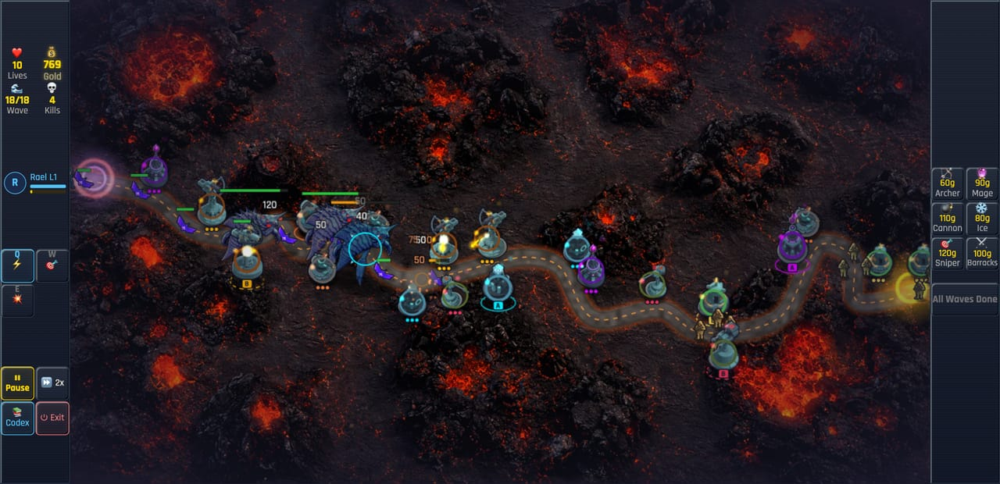

Last Light is a browser tower-defense game with 10 maps, 6 tower types that each branch at
tier 4 into one of two forms (12 tier-4 forms), 6 enemy types, 4 heroes and a storyline.
That is the whole pitch; the rest of this page is for engineers, and is mostly about how it
was built.

**Play:** <https://tower-defense-black.vercel.app>, which deploys from `main`. This page was
written on 2026-11-23 on `visual/integration`, then 535 commits ahead of `main`, so on that
date the live site did not yet have the newest work below: hi-DPI rendering, the
performance pass, itch.io packaging and the licence notices.

**Stack:** Phaser 3.90 (WebGL), plain ES-module JavaScript (no framework, no TypeScript),
Vite 5, Vitest 2 with jsdom, and Playwright for the browser harness.

### At a glance (as of 2026-11-23)

| | |
|---|---|
| Commits | 1,243 on `visual/integration`, from 2026-05-09 to 2026-11-23 (merges and docs commits included) |
| Pull requests | 142, all merged |
| Design specs / implementation plans | 71 / 83, under [`docs/superpowers/`](docs/superpowers/) |
| Session journals | 46, under [`.claude/sessions/`](.claude/sessions/) |
| Tests | 4,233 Vitest tests in 261 files, all passing |
| Source | 215 non-test modules (22,770 lines of JavaScript) in [`src/`](src/) |

Counts are taken on `visual/integration` at `4d6c9ee`, before this README's own commits.
Maps are numbered from 0 here, as in `src/data/maps.js`; the game shows them as missions 1
to 10.

## Contents

- [How it was built](#how-it-was-built)
- [What the process caught](#what-the-process-caught)
- [Before and after](#before-and-after)
- [Architecture](#architecture)
- [Testing and verification](#testing-and-verification)
- [The art pipeline](#the-art-pipeline)
- [Running it](#running-it)

## How it was built

### Who did what

I directed; Claude Code, Anthropic's coding agent, implemented. Concretely:

| Me | Claude Code |
|---|---|
| Chose what to build and in what order (the prioritized backlog in [`.claude/notes.md`](.claude/notes.md#prioritized-backlog)) | Wrote the design specs and implementation plans |
| Answered the design questions in each brainstorm; approved specs and plans, except on `[auto]` items (see step 2 below) | Wrote the code, the tests and the docs, including this README |
| Made the design and legal calls: for example, strip a GPL-3.0 polyfill out of Phaser rather than ship it, and raise map 9's starting gold from 300 to 690 | Ran the reviews, as separate reviewer agents |
| Merged the PRs; kept the visual sign-off gates, the `visual/integration` → `main` release, deploys and the "Last Light" trademark check | Ran the verification: the browser harness, the perf gate, the balance simulator |

Every commit is under my git identity (merges under my GitHub account), except one roadmap
doc committed as Claude ([`d86ab75`](https://github.com/Kbtimko/tower-defense/commit/d86ab75)).
Claude Code wrote the code from the start. The `Co-Authored-By: Claude` trailer first
appears on 2026-05-10 and is on every commit after 2026-06-24: 890 of the 1,101 non-merge
commits as of 2026-11-23. The 211 without it are from May and June 2026, before the trailer
was added consistently.

The pipeline below is what makes that division workable. Every step writes something down
(a spec, a plan, a PR body, a journal), so the claims below link to their evidence.

### The pipeline

```
brainstorm → spec → plan
  → for each task: fresh implementer agent → task reviewer agent → fix rounds
  → whole-branch review (most capable model) → one fix wave → scoped re-review
  → live verification in the running game
  → PR into visual/integration → I merge
```

1. **Brainstorm → spec.** Claude Code asks me design questions and offers alternatives;
   I make the calls. The result is a short spec in
   [`docs/superpowers/specs/`](docs/superpowers/specs/) with my decisions recorded at the
   top (see [this README's own spec](docs/superpowers/specs/2026-11-23-portfolio-readme-design.md)).
2. **Plan.** A task-by-task plan in [`docs/superpowers/plans/`](docs/superpowers/plans/):
   the files each task touches, the failing test to write first, and the commands that
   prove it. An untagged backlog item waits for my approval of the spec and plan. On an
   item I tag `[auto]`, Claude Code approves its own and runs through to an open PR, but
   still stops to ask on a scope change, a missing requirement, a legal question or
   anything irreversible. Backlog #81 was one: it stopped to ask me about the GPL polyfill
   (incident 6).
3. **One fresh agent per task.** The session running the plan does not write the code. For
   each task it dispatches a new implementer subagent, which starts with no memory of
   earlier tasks and works from that task's brief, then a separate reviewer subagent that
   checks the diff against the spec and for quality. Findings go back to the implementer
   as fix rounds.
4. **Whole-branch review.** When every task is done, one review of the whole branch on
   the most capable model available (Opus), then a single fix wave and a scoped re-review.
5. **Live verification.** A green suite is not "done". The change is exercised in the
   running game: a production or capture build driven by Playwright with real input on
   desktop and phone viewports, screenshots the agent opens and looks at, and, for visual
   work, a frozen-frame A/B against the base branch.
6. **PR.** Into the integration branch (now `visual/integration`), with the verification
   evidence in the PR body. I merge. The standing rule: no direct pushes to `main`.

### Standing rules

Two rule files steer every session.

- **[`CLAUDE.md`](CLAUDE.md)** (in the repo): the stack and commands; tunable numbers live
  in `src/data/` and never in entity logic; pure logic stays out of Phaser lifecycle
  methods so Vitest and jsdom can test it; the **mutation-check rule** (every new test must
  fail with its fix reverted, and no assertion may let expected and actual coincide by
  accident); and a Definition of Done (enumerate the edge cases, validate in the running
  game, name the root cause rather than the surface patch).
- **My global rules** (in my home directory, not in this repo): changes land only through
  PRs, never by pushing to `main`; stage explicit paths, never `git add -A`; one git
  worktree per feature; a failing test first, then a live check, reported as command, raw
  output and conclusion.

A hook, [`.claude/hooks/related-tests.sh`](.claude/hooks/related-tests.sh), reruns the
Vitest tests related to each file Claude Code edits and wakes it when one fails.

### Memory between sessions

Each session starts cold, so the state lives in files:

- [`.claude/notes.md`](.claude/notes.md): current status, blockers, the prioritized
  backlog, and a "Hard-won facts worth not re-deriving" list.
- [`.claude/sessions/`](.claude/sessions/): 46 session journals (as of 2026-11-23), one
  per working session.
- Claude Code also keeps a per-project memory of lessons outside the repo. It is not
  committed, so nothing on this page relies on it.

### A worked example: roadmap 6.2, itch.io packaging

One complete chain, from design to merge:

- Spec: [`2026-11-22-build-package-design.md`](docs/superpowers/specs/2026-11-22-build-package-design.md)
- Plan: [`2026-11-22-build-package.md`](docs/superpowers/plans/2026-11-22-build-package.md)
- PR: [#141](https://github.com/Kbtimko/tower-defense/pull/141), 18 commits, 26 files,
  +1,282 / −68. Its body records one review per task (Task 4 needed two fix rounds), an
  Opus whole-branch review with 1 Important and 4 Minor findings, one fix wave, a scoped
  re-review that came back clean, a mutation check on every task, and 4,161 tests in 253
  files passing at merge.
- Journal: [`.claude/sessions/2026-11-23-build-package.md`](.claude/sessions/2026-11-23-build-package.md)

It also records a judgement call mid-build: the first policy for the store screenshots
produced half-empty boards, and the controlling session looked at the output, rejected it
and had the policy redone (a decision it recorded in the PR body as "Ruling F"). The
portrait bug in incident 5 below was caught in PR #141.

## What the process caught

Six incidents from the history. Each shows a check working, or a check failing and being
tightened afterwards.

### 1. Enemy spawns multiplied on every replay

- **Symptom:** reported from play: wave 1 of the first level had at least 12 enemies, but the wave table says 6. Each retry added 6 more (6 → 12 → 18 → 24). The balance simulator never saw it because it builds a fresh `WaveManager` per run.
- **Cause:** `GameScene.create()` registered five listeners on `this.events` and `shutdown()` removed none. Phaser's scene emitter outlives the scene, so every entry stacked one more `enemy:spawn` listener.
- **Fix:** a matched `_wireSceneEvents` / `_unwireSceneEvents` pair, a named method in place of an inline arrow (`off()` matches by identity), and `once('shutdown')`. Four new tests fail on the old code. The PR says plainly it was verified through the real `WaveManager`, not in a browser.
- **Links:** [`3d540e2`](https://github.com/Kbtimko/tower-defense/commit/3d540e2), [PR #72](https://github.com/Kbtimko/tower-defense/pull/72), [`GameScene.shutdown.test.js`](src/scenes/GameScene.shutdown.test.js)

### 2. A HUD launch bug, then a false "works on replay"

- **May 2026:** UIScene "was registered in the scene array but never started", so the hero HUD events "fired into the void" ([`8cb1d20`](https://github.com/Kbtimko/tower-defense/commit/8cb1d20)). Fix: `GameScene.create()` launches it.
- **October:** GameScene's shutdown "clones every .tower-btn to drop its own handlers, which also stripped UIScene's tooltip listeners: from the second level on, hovering a tower showed nothing" ([`9696b4a`](https://github.com/Kbtimko/tower-defense/commit/9696b4a)). [`63b6ade`](https://github.com/Kbtimko/tower-defense/commit/63b6ade) then removed UIScene's orphaned wiring and added [`UIScene.eventWiring.test.js`](src/scenes/UIScene.eventWiring.test.js), a source-derived guard that fails on any new cross-scene orphan.
- **The false claim:** an earlier session had told me the tooltip "works on replay". The text it read was stale hidden content from the first hover; planting a sentinel string before hovering exposed it, and the correction went into the notes ([`c99a9a7`](https://github.com/Kbtimko/tower-defense/commit/c99a9a7)).
- **Links:** [PR #83](https://github.com/Kbtimko/tower-defense/pull/83), [journal](.claude/sessions/2026-10-08-uiscene-orphans.md) ("Correction to my own earlier claim")

### 3. Tests that passed while proving nothing

- **Symptom:** during the September 2026 simulator work (PRs [#77](https://github.com/Kbtimko/tower-defense/pull/77) and [#78](https://github.com/Kbtimko/tower-defense/pull/78)), reviewers found several assertions that passed against broken code, nearly all in plans Claude Code had written itself. One guard test in [`mapsEconomy.test.js`](src/data/mapsEconomy.test.js) was defeated by a flat 120-gold campaign that passed all five assertions while leaving the game worse.
- **Caught by:** the per-task and final reviewers, who built the regression and watched the test stay green.
- **Fix:** every fix was proven by reintroducing the bug and watching that specific test fail. Prompted by Claude Code's `/insights` report on my past sessions, this became the mutation-check rule in [`CLAUDE.md`](CLAUDE.md) ([PR #135](https://github.com/Kbtimko/tower-defense/pull/135)); the PR bodies of #140 to #142 each record their mutation checks.

### 4. Jagged pad edges after a performance bake

- **Symptom:** baking the static layer (pads, blockers, platforms) into a Phaser RenderTexture to save CPU made the pad edges jagged.
- **Caught by:** the frozen-frame A/B against the base branch flagged a difference, and a 4x crop confirmed the jagged edges.
- **Cause and fix:** a Graphics drawn into a RenderTexture loses the main canvas's MSAA. The bake moved to Canvas2D (`Graphics.generateTexture`), which antialiases: [`0c3a8b8`](https://github.com/Kbtimko/tower-defense/commit/0c3a8b8) → [`3e71218`](https://github.com/Kbtimko/tower-defense/commit/3e71218), [PR #140](https://github.com/Kbtimko/tower-defense/pull/140), [`staticLayerBake.js`](src/systems/staticLayerBake.js).

### 5. Portrait URLs that would have 404ed on itch.io

- **Symptom (never shipped):** itch.io serves a game from a subfolder (`/html/12345/`). The story dialog and results screen built root-absolute `/assets/portraits/...` URLs, so there the portraits would 404 and fall back to the speaker's initial.
- **Caught by:** the new `package:itch` check, which unpacks the zip into `/html/12345/` and plays the device flow on desktop and iPhone through [`staticServer.mjs`](scripts/staticServer.mjs), an exact-case server with no SPA fallback. Vite preview and macOS would both have hidden it.
- **Fix:** relative paths ([`56f0052`](https://github.com/Kbtimko/tower-defense/commit/56f0052), [PR #141](https://github.com/Kbtimko/tower-defense/pull/141)). The final review then checked all 251 manifest and audio URLs against the production tree: 0 missing, 0 case mismatches.

### 6. A GPL-3.0 polyfill inside Phaser

- **Symptom:** none in play. Phaser 3.90's `requestVideoFrame` polyfill is a copy of `rvfc-polyfill`, which is GPL-3.0, and it was in the shipped bundle. A notice does not satisfy the GPL.
- **Caught by:** the final review of the third-party-notices work, which also found code Phaser inlines with no notice (Matter.js, Simplify.js, klasse). The implementer confirmed it on npm, on GitHub and in the built JS.
- **Decision and fix:** my call was to strip it, since the game never uses Phaser video. A Vite plugin removes the block at build time and throws unless Phaser's marker appears exactly once, so a Phaser upgrade fails the build until it is rechecked; every build also fails if the polyfill reaches the output, and `package:itch` rescans the zip.
- **Links:** [`c81175c`](https://github.com/Kbtimko/tower-defense/commit/c81175c), [`4fc3b3c`](https://github.com/Kbtimko/tower-defense/commit/4fc3b3c), [PR #142](https://github.com/Kbtimko/tower-defense/pull/142), [`vitePluginNotices.mjs`](scripts/vitePluginNotices.mjs), [`docs/licenses.md`](docs/licenses.md)

## Before and after

"Before" is the 2026-10-21 baseline in [`docs/baseline/2026-10-21/`](docs/baseline/2026-10-21/),
described in [`docs/visual-baseline.md`](docs/visual-baseline.md). "After" was reshot on
2026-11-23 with the same capture-harness commands. The layout changed a lot in between, so
a pair shows the same moment, device and map, not the same widgets. Sources and commands
for every image: [`docs/readme/PAIRS.md`](docs/readme/PAIRS.md).

| Before (2026-10-21) | After (2026-11-23) |
|---|---|
| 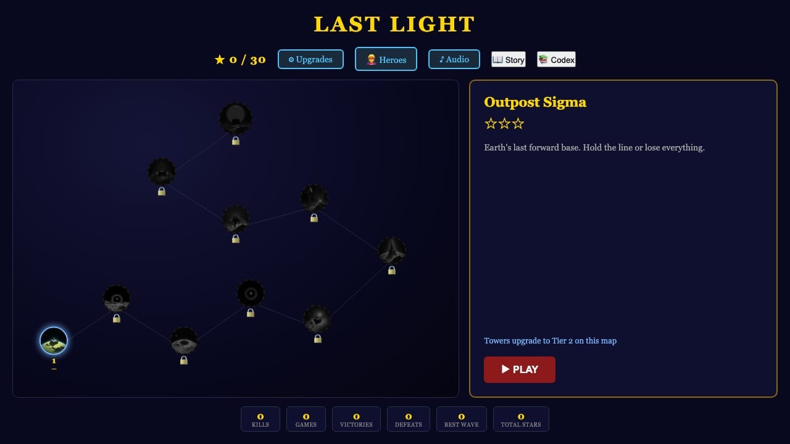<br>**Map select, desktop.** First run, map 1 open, nothing unlocked. | 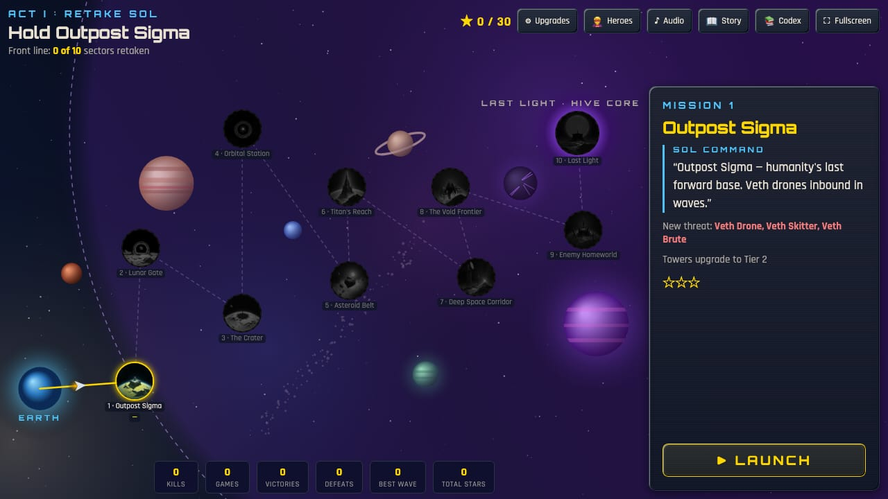<br>Same first-run save: the node list became a star map of named sectors, and the side panel a mission briefing. |
| 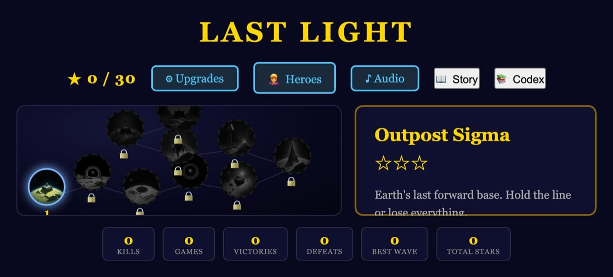<br>**Map select, iPhone.** The PLAY button was clipped out of reach. | 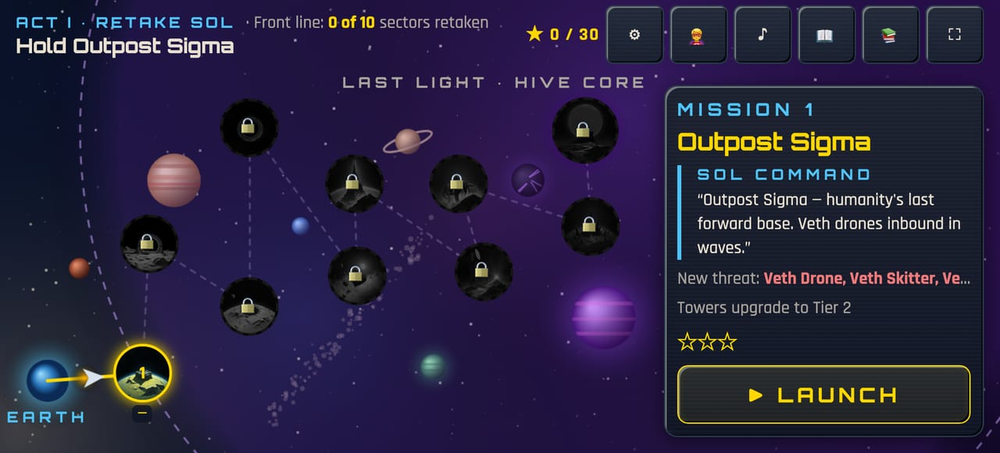<br>LAUNCH is visible. |
| 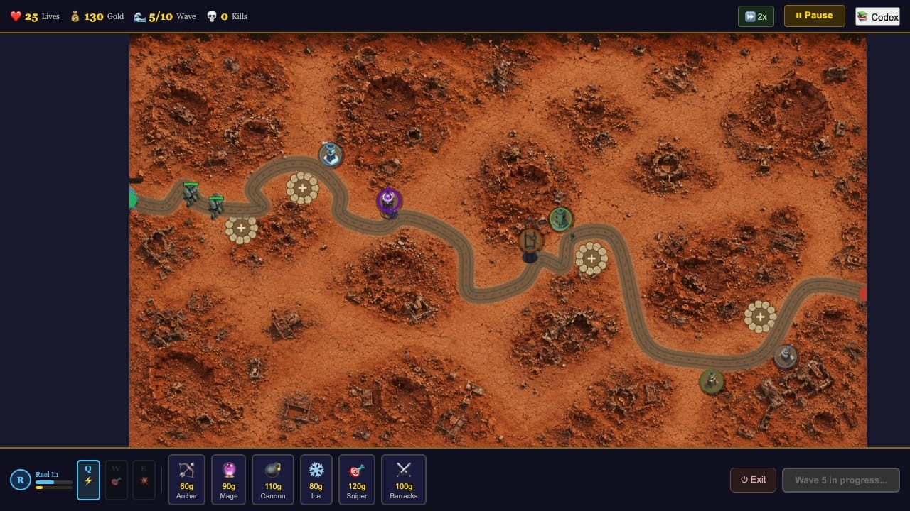<br>**In game, map 0, desktop.** Wave 5 of 10, same save and same towers. | 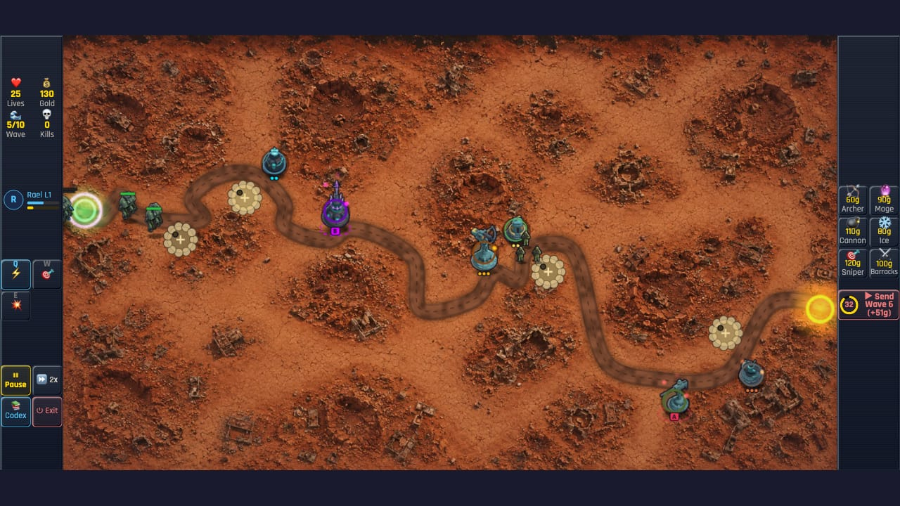<br>The top and bottom bars became side rails, and the bottom tower bar a right-hand rail. |
| 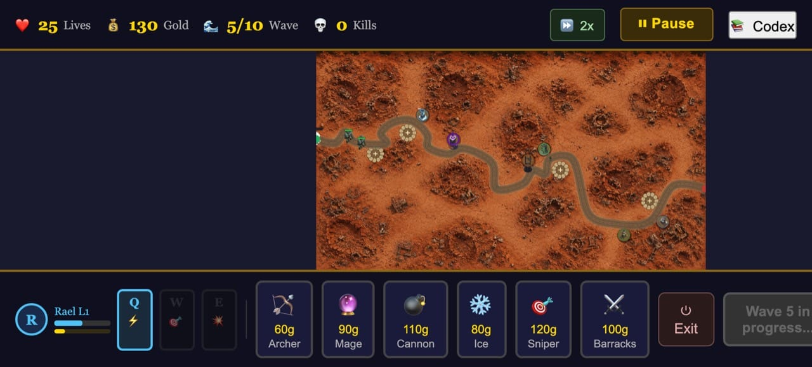<br>**In game, map 0, iPhone.** The board filled about a third of the screen. | 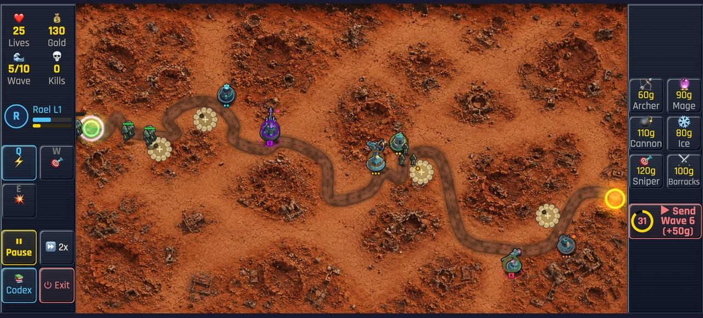<br>The phone fix: the board fills the screen. |
| 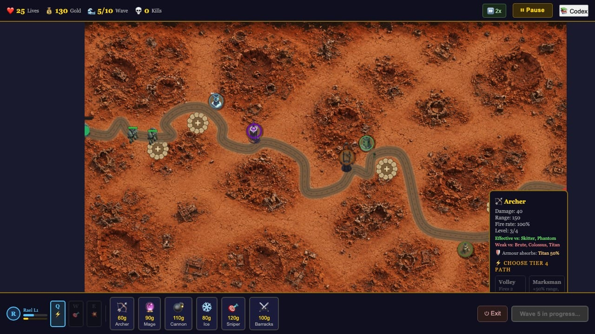<br>**Tower panel, desktop.** The same tier-3 archer selected on map 0, wave 5. | 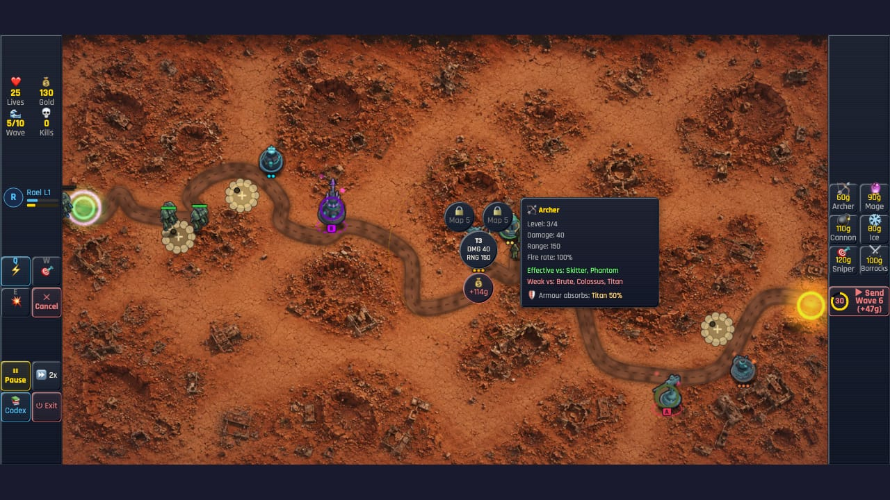<br>Not the same widget: the panel was replaced by a radial ring of actions and a stats tooltip. The locked tier-4 branches read "Map 5". |
| 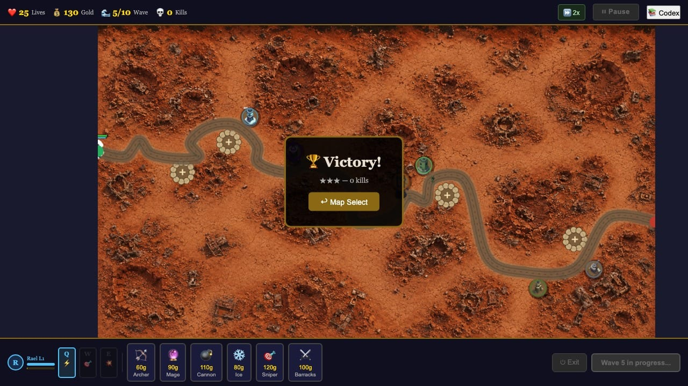<br>**Victory, desktop.** A small modal. | 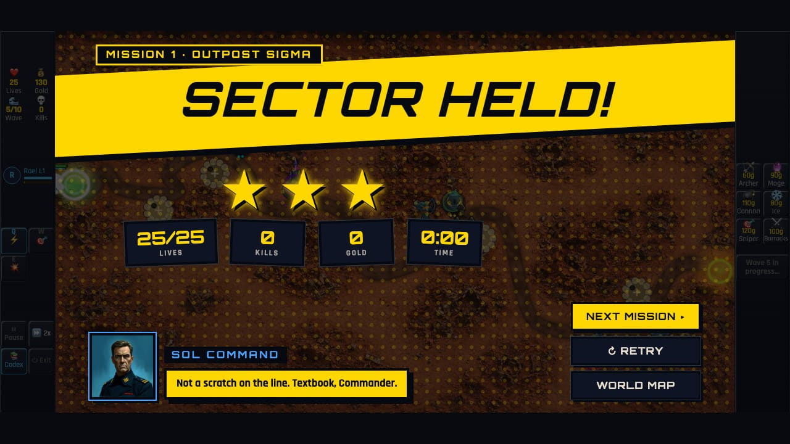<br>A full results screen. It shows 0 kills and 0:00 because the capture harness forces the win (the HUD still reads wave 5 of 10); the before was forced the same way. |
| 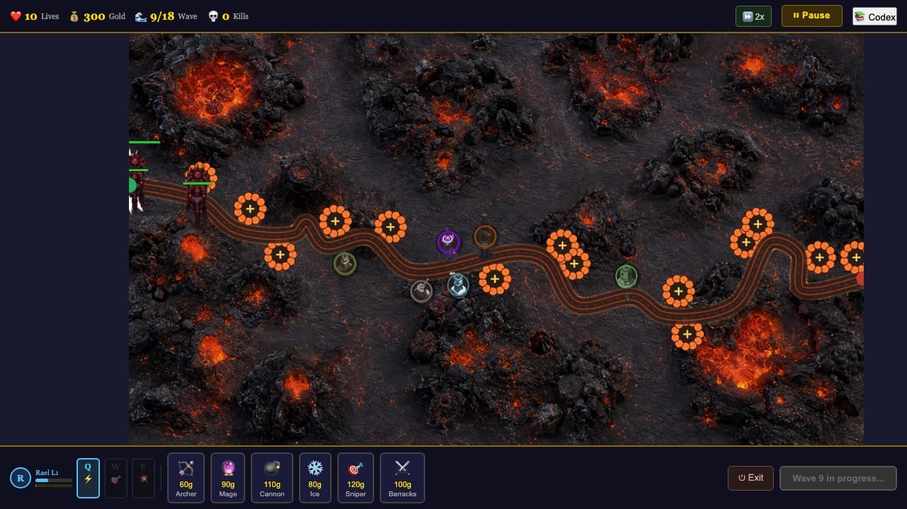<br>**In game, map 9, desktop.** Wave 9 of 18, 10 lives. | 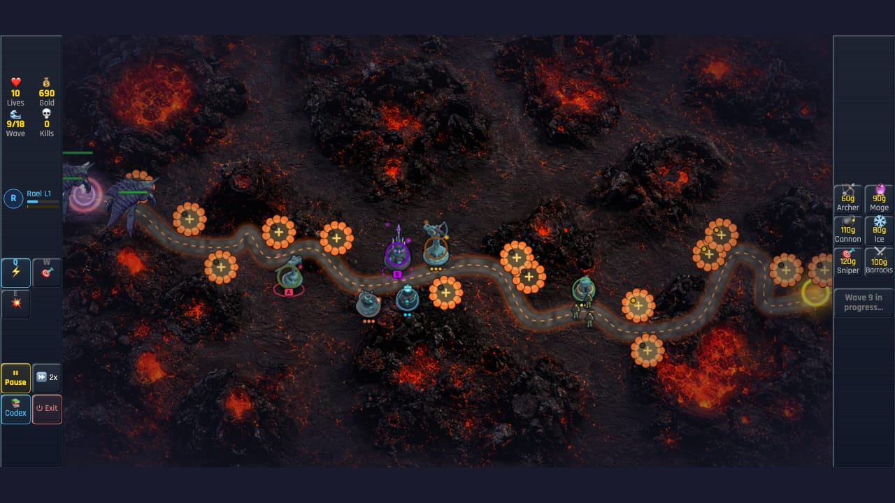<br>Same wave and lives. Gold reads 690, not 300, because [PR #130](https://github.com/Kbtimko/tower-defense/pull/130) raised map 9's starting gold. |

## Architecture

```
src/scenes/   Phaser scenes (Title, MapSelect, Game, UI ...)      src/sim/   balance simulator
     │                                                                 │
     └───────────────────────────────┬─────────────────────────────────┘
                                     ▼  both import
src/systems/  pure logic: damage, waves, paths, economy, tower shots, render scale ...
                                     ▼  reads
src/data/     every tunable number: maps, towers, enemies, waves, heroes, perf budget
```

Two rules from [`CLAUDE.md`](CLAUDE.md) shape the code. Tunable numbers live in
[`src/data/`](src/data/), never in entity logic. Logic that doesn't touch the scene graph is
a pure function in [`src/systems/`](src/systems/), so Vitest and jsdom can test it without a
canvas.

The simulator imports the modules the game runs (`WaveManager`, `computeDamage`,
`PathManager`, and the tier-4 shot resolver [`towerShot.js`](src/systems/towerShot.js)), so it
scores the game's actual rules rather than a copy of them. See
[`src/sim/simulate.js`](src/sim/simulate.js).

### The balance simulator

`npm run balance` ([`scripts/balance.mjs`](scripts/balance.mjs)) plays every map with a
modelled player and reports; it never edits `src/data/maps.js`. The current headline is a
hindsight best-of-5 barracks strategy (the barracks is the tower that sends soldiers onto
the road), "a player who retries". As of 2026-11-23 it rates 9
of 10 maps winnable, flags map 2 as too easy, and finds map 7 unwinnable without 1.05x
damage. The report itself says the model is pessimistic: it omits hero abilities, meta
upgrades, soldier repositioning and the send-wave-early bonus. All of these numbers are
simulated; none has been checked by human playtesting yet.

What it found, from [`.claude/notes.md`](.claude/notes.md) and the PRs:

- **A difficulty cliff** ([#49](https://github.com/Kbtimko/tower-defense/pull/49)).
  `findWinMultiplier`, the uniform damage multiplier at which a map clears, turned
  "unwinnable" into a number and exposed a cliff between maps 6 and 7 (map 7 jumped to
  3.63x). It was kept as a design choice; it survives every model variant, and tests in
  [`waves.test.js`](src/data/waves.test.js) hold map 7 out of a later enemy swap.
- **Barracks were a net loss** ([#53](https://github.com/Kbtimko/tower-defense/pull/53),
  [#54](https://github.com/Kbtimko/tower-defense/pull/54)) on 9 of 10 maps. The cause was a
  duty cycle (2.25 s of squad uptime against a 3 s respawn), not a weak stat. Respawn
  3 → 2 s and enemy melee damage 20 → 12 made a barracks help on all ten maps.
- **Matchup blindness** ([#77](https://github.com/Kbtimko/tower-defense/pull/77)). Scoring
  purchases through the real `computeDamage` against the enemies still to come moved map 9's
  win multiplier by −0.76x. The final review proved the old-behaviour column reproduced the
  pre-branch code: 120 runs, zero differences.
- **Gold timing, not difficulty** ([#78](https://github.com/Kbtimko/tower-defense/pull/78)).
  Starting gold fell 130 → 100 across the campaign while enemy HP rose 8.3x, so map 9 opened
  with one tower on twenty slots. Moving the same total gold earlier improved every map.
- **A yardstick that could not see tier 4.** `cheapestFullBoardCost` priced an archer at
  110 (tier 2) when tier 4 costs 310, which hid a 2.4x collapse in purchasing power;
  `depthBoardCost` in [`economy.js`](src/sim/economy.js) is the right measure.
- **Map 9 under-funding.** The sim showed map 9 dying on wave 1 with 3 of 20 towers built.
  A sweep showed only early gold moved it, and I picked 300 → 690 (map 8: 270 → 405),
  pinned in [`mapsEconomy.test.js`](src/data/mapsEconomy.test.js)
  ([spec](docs/superpowers/specs/2026-11-19-map9-funding-design.md)).

### Deferred assets

Several features shipped ahead of their art or audio. A pure key-deriving helper
([`sfxKeys.js`](src/systems/sfxKeys.js), [`portraitFallback.js`](src/systems/portraitFallback.js),
[`spriteKeys.js`](src/systems/spriteKeys.js)) falls back to a placeholder until the real
file is registered, so the asset drops in with no code change, or a one-line one.

### Hi-DPI rendering

A pure `renderScaleFor` ([`renderScale.js`](src/systems/renderScale.js)) picks a render scale
k of 1 or 2 once at boot. Two measurements came first. Phaser 3.90 runs WebGL1, which
mipmaps only power-of-two textures, so the 1x sheets stay for k = 1 and 81 `@2x` sheets
(+4.33 MB) load only at k = 2. And Phaser pre-allocated 69 PreFX render targets (about
57 MB, about 420 MB at k = 2); [`rendererConfig.js`](src/systems/rendererConfig.js) cuts
them to 3.

## Testing and verification

- **Unit tests:** 4,233 Vitest tests in 261 files as of 2026-11-23 (`npm test`). Game logic
  runs under jsdom with no canvas. Several guards derive their checks from the source of
  truth rather than a hand-kept list:
  [`licenseLedger.test.js`](src/assets/licenseLedger.test.js) reads the disk,
  [`UIScene.eventWiring.test.js`](src/scenes/UIScene.eventWiring.test.js) reads the scene
  source, and [`readmeLinks.test.js`](src/assets/readmeLinks.test.js) checks every relative
  link on this page with exact case.
- **Screenshot harness:** `npm run capture` ([`capture.mjs`](scripts/capture.mjs)) builds the
  game in capture mode (debug hooks compiled in; the production build strips them) and
  shoots maps, waves and screens on any device profile in
  [`captureDevices.mjs`](scripts/captureDevices.mjs). The gallery above came from it.
- **Device matrix:** `npm run matrix` plays the game flow with real input on desktop, phone
  and tablet profiles.
- **Perf gate:** `npm run perf` ([`perf.mjs`](scripts/perf.mjs)) plays the busiest wave of
  each map on the real GPU and fails below the budget in
  [`perfBudget.js`](src/data/perfBudget.js): desktop 1440×900 at 2x needs ≥ 57 fps and
  p95 ≤ 20 ms; the iPhone profile at 4x CPU throttle needs ≥ 30 fps and p95 ≤ 34 ms. It
  refuses a verdict on a loaded machine or a software renderer. In the 6.1 performance pass
  ([PR #140](https://github.com/Kbtimko/tower-defense/pull/140)) profiling found earcut
  (Phaser's polygon triangulator) re-triangulating static fills at about 47% of CPU (6x
  throttle). After that pass, map 9's
  last wave on the iPhone profile at 8x CPU throttle went from 22.6 fps (p95 50.1 ms, a
  fail) to 59.3 fps (p95 16.8 ms), measured on an Apple M4.
- **Packaging check:** `npm run package:itch` ([`package-itch.mjs`](scripts/package-itch.mjs))
  builds a relative-base bundle, checks it against itch.io's limits, zips it
  deterministically, then unpacks it into a nested folder and plays the flow from there. Its
  last recorded run (PR #141): 306 files, 32.5 MB, desktop 17/17 and iPhone 18/18 checks
  passing.
- **Frozen-frame A/B:** for visual work, the same frozen frame is captured on the base and
  on the branch and diffed, and differences are inspected in a 4x crop. That is how
  incident 4 was caught.

## The art pipeline

Sprites, portraits and overworld nodes are generated locally with FLUX.1 [schnell] through
Draw Things' HTTP API. Map backdrops came from ChatGPT image generation, and the audio is
CC0. The loop, documented in [`scripts/art/README.md`](scripts/art/README.md):

1. `npm run art -- --job <batch>` generates candidates for each asset in a job file
   ([`scripts/art/jobs/`](scripts/art/jobs/)), then makes rembg cutouts and game-size
   previews.
2. `npm run art:review -- <batch>` writes a review page. One candidate is picked per asset
   (or flipped, or marked for a reroll), and the picks download as `picks.json`.
3. `npm run art:apply -- picks.json` installs the picks, rebuilds the sprite sheets, and
   runs the strict asset check and `npm test`. It never commits.
4. The result is checked in a production build, then committed with explicit paths.

Sprites ship as 1x sheets plus an `@2x` set (frames doubled, scale halved, so on-screen
size is unchanged). The 2x pass fails if a silhouette's ground line drifts from the 1x
manifest. Jobs pin their seed, and the seed behind the shipped art is on record in the art
README. A `--fake` mode makes stand-ins so the whole loop is tested end to end without a GPU
([`pipeline.e2e.test.js`](scripts/art/pipeline.e2e.test.js)).

Provenance is tracked in a licence ledger, [`docs/licenses.md`](docs/licenses.md): where
every shipped third-party or generated asset came from and what it allows.
[`licenseLedger.test.js`](src/assets/licenseLedger.test.js) fails when a runtime dependency,
an asset folder or an audio file is missing from it.

## Running it

Requires Node and npm.

```
npm install
npm run dev
npm test
```

| Script | What it does |
|---|---|
| `npm run dev` | Vite dev server |
| `npm test` / `npm run test:watch` | The Vitest suite, once or watching |
| `npm run build` / `npm run preview` | Production build to `dist/`, and a local server for it |
| `npm run balance` | Balance report per map; never edits `src/data/` |
| `npm run calibrate:autosend` | Auto-send timing calibration (report only, takes minutes) |
| `npm run capture` | Screenshot harness (Playwright) |
| `npm run matrix` | Device-flow matrix (`capture --flow`) |
| `npm run perf` | Frame-rate gate on the real GPU |
| `npm run package:itch` | Build, check, zip and play-test the itch.io bundle |
| `npm run release:media` | Store screenshots, cover and gameplay clip |
| `npm run assets` | Asset inventory; `--strict` fails on a missing required asset |
| `npm run optimize-assets` | Derive the shipped WebP backdrops from their sources |
| `npm run art` / `art:review` / `art:apply` | The art pipeline above (needs Draw Things) |

The browser scripts need Playwright's Chromium (`npx playwright install chromium`).

**Licences.** [`docs/licenses.md`](docs/licenses.md) records where every shipped
third-party or generated asset came from and what it allows. Every build also emits a
`THIRD_PARTY_NOTICES.txt` with the licence texts, generated from the bundle by
[`vitePluginNotices.mjs`](scripts/vitePluginNotices.mjs); `npm run package:itch` refuses a
build without it.
